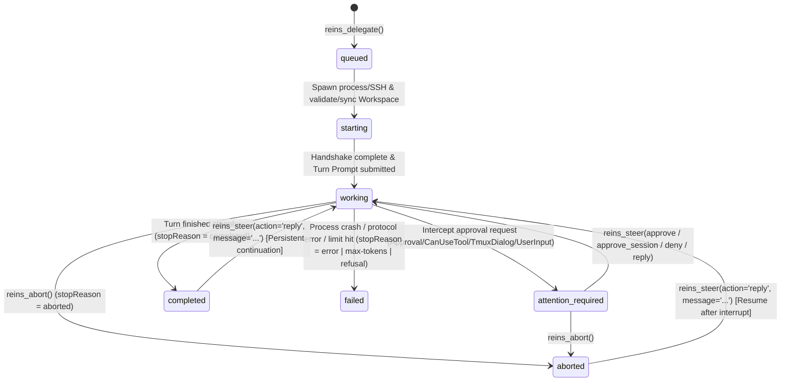

# Reins H2H (Harness-to-Harness) Protocol Specification v0.2

> **Status**: Draft v0.2 (Aligned with OpenAI `codex-plugin-cc` / `codex app-server`, DeepSeek Harness `@deepseek-ai/dsh-subagent*`, ACP, and `dsh-claude-vps`)  
> **Scope**: Defines the standardized protocol for capability discovery, task delegation, multi-turn steering/resumption, interactive permission governance, and mobile notification synchronization across local and remote AI Coding Harnesses via **Reins Hub**.

---

## 1. Design Goals & Ecosystem Compatibility Principles

Reins H2H synthesizes existing cross-harness communication patterns into a **unified, cross-platform (Windows + Ubuntu), transport-agnostic (Local + SSH) superset specification**:

1. **Full Compatibility with DeepSeek Harness (`@deepseek-ai/dsh-subagent*`) Contracts**:
   - Preserves DSH's strict separation between **`output`** (final assistant response blocks) and **`diagnostic`** (structured, credential-safe failure and permission facts), as well as the canonical `stopReason` vocabulary (`completed` | `aborted` | `error` | `max-tokens` | `refusal`).
   - Supports both lifecycle paradigms from `tool-subagent` and `tool-subagent-control`, aligning with `subagent`, `send_message`, `interrupt_agent`, and `list_agents`.
   - **Beyond DSH's Unattended Limitation**: Overcomes DSH's restriction where `subagent-codex` and `subagent-claude-code` only run locally in one-shot unattended mode and hard-reject every runtime approval request (`declined`/`denied`).
2. **Dialectical Dual-Mode Session Governance (`persistent` First-Class vs. `ephemeral` One-Shot)**:
   - Balances **human resumability** against **session list signal-to-noise ratio**:
     - **`persistent` Mode (First-Class User Session)**: Used for substantial feature work, multi-file refactoring, deep debugging, and iterative multi-turn tasks. Sessions are persisted directly in the target Harness's **default user session store** (`~/.codex/sessions`, `~/.claude/projects`, `~/.dsh`), making them immediately visible and resumable by the human user in native clients (`codex resume`, `claude --resume`, DSH UI, or `tmux attach`).
     - **`ephemeral` Mode (Burn-After-Reading / One-Shot Session)**: Used for granular queries, data/summary exports, single-pass code reviews, and high-frequency micro-tasks. Drivers use native ephemeral/isolated flags (`ephemeral: true` in Codex, `persistSession: false` in Claude SDK, isolated home in DSH) so micro-tasks **never dilute or clutter the user's valuable session history**.
3. **Full Compatibility with OpenAI Codex Official Protocols (`codex-plugin-cc` / `codex app-server` / `codex mcp-server`)**:
   - Drives local or remote Codex via **`codex app-server --stdio`** JSON-RPC 2.0 (`initialize`, `thread/start`, `thread/resume`, `turn/start`, `turn/interrupt`, and reverse `item/*/requestApproval` interception).
   - Compatible with `codex-plugin-cc` workflow presets (`task`, `review`, `adversarial-review`, `rescue`) and session handoff (`codex resume <threadId>`).
4. **Full Compatibility with `dsh-claude-vps` Interactive Tmux + JSONL Protocol**:
   - Supports driving interactive Claude Code over `SSH + Tmux Bracketed Paste + JSONL Transcript Watcher + Capture-Pane Dialog Detection`, including `attachTmux` and `resumeSessionId`.
5. **Full Compatibility with ACP (`@agentclientprotocol/sdk`)**:
   - Supports `initialize` $\rightarrow$ `session/new` / `session/resume` / `session/list` $\rightarrow$ `session/prompt` and `session/request_permission`.

---

## 2. Core Terminology & Cross-Harness Mapping

Reins exposes **two 100% isomorphic Northbound Surfaces**—**CLI + Agent Skill (`reins <subcommand>` + `skills/reins/SKILL.md`)** and **MCP Server (`reins-mcp`)**:

| Reins Concept | MCP Tool (`reins-mcp`) | CLI Subcommand (`reins` + `SKILL.md`) | DSH Equivalent (`dsh-subagent`) | OpenAI Equivalent (`codex-plugin-cc` / `mcp`) | `dsh-claude-vps` Equivalent | Description |
| :--- | :--- | :--- | :--- | :--- | :--- | :--- |
| **Target** | `reins_targets` | `reins targets [--json]` | `list_agents` / `providerName` | `/codex:setup` | `claude_vps_status` (targets) | Discover configured local/remote Harness targets and active/resumable sessions. |
| **Hand Over** | `reins_delegate` | `reins delegate <target> [options]` | `subagent_<provider>` | `codex` / `task` / `review` | `claude_vps_start` + `claude_vps_send` | Delegate a task to a target Harness (foreground wait with graceful background fallback). |
| **Inspect** | `reins_status` | `reins status [taskId] [options]` | `list_agents` / `job_output` | `status` / `result` | `claude_vps_status` + `claude_vps_read` | Query task status, incremental transcript (`sinceSeq`), pending approval dialogs, and final output. |
| **Steer** | `reins_steer` | `reins steer <taskId> <action> [msg]` | `send_message` | `codex-reply` / Approval RPC | `claude_vps_send` / `claude_vps_key` | **Unified Control Primitive**:<br>1. When `attention_required`: approve/deny permission prompts (`approve` / `approve_session` / `deny`);<br>2. When `completed`/`idle`: send follow-up turn (`reply`);<br>3. When `working`: inject mid-turn steering instruction. |
| **Pull the Reins** | `reins_abort` | `reins abort <taskId> [--kill]` | `interrupt_agent` / `job_kill` | `cancel` / `turn/interrupt` | `claude_vps_interrupt` / `stop` | Interrupt the active turn (keeps underlying session resumable by default unless `--kill` / `terminateSession: true` is passed). |

---

## 3. Target Capability Declaration: `HarnessCard`

Every target registered in `reins.yaml` exposes a standardized `HarnessCard`:

```json
{
  "id": "local-codex",
  "label": "Local OpenAI Codex (app-server)",
  "harnessType": "codex",
  "transport": {
    "kind": "local",
    "platform": "win32"
  },
  "driver": {
    "mode": "codex-app-server",
    "command": "auto",
    "capabilities": {
      "persistentSession": true,
      "ephemeralSession": true,
      "interactiveApproval": true,
      "midTurnSteer": true,
      "modelSelection": true,
      "outputSchema": true,
      "attachExisting": true
    }
  },
  "workspace": {
    "defaultWorkdir": "C:/Users/ariab/Desktop/workspace/reins",
    "allowedSyncModes": ["remote-native", "context-only"]
  },
  "reinPolicy": "auto-edit",
  "tags": ["coding", "review", "adversarial-review", "rescue"],
  "status": {
    "availability": "online",
    "activeTasks": 0
  }
}
```

---

## 4. `ReinPolicy` & Native Permission Mapping Matrix

Reins defines **5 standard `ReinPolicy` levels** and automatically translates them into each Harness's native permission and sandbox parameters:

| H2H `ReinPolicy` | Policy Semantics | **Codex (`codex-app-server`)** Mapping | **Claude Code (`claude-tmux` / `claude-sdk`)** Mapping | **ACP (`acp` / `dsh`)** Mapping | Hub Runtime Approval Behavior |
| :--- | :--- | :--- | :--- | :--- | :--- |
| **`free-rein`** | Unattended full access (for isolated sandboxes/containers) | `approvalPolicy: 'never'`,<br>`sandbox: 'danger-full-access'`<br>(or auto-reply `accept`) | `--permission-mode bypassPermissions`<br>(or auto-key `1. Yes`) | Auto-select `allow_always` / `allow_once` | **Auto-approves** without suspending the task; records approval fact in `diagnostic`. |
| **`auto-edit`** | Autonomous workspace edits & safe commands; gates risky operations | `approvalPolicy: 'on-request'`,<br>`approvalsReviewer: 'auto_review'`,<br>`sandbox: 'workspace-write'` | `--permission-mode acceptEdits` | Auto-allow `read`/`edit`/`search`; gate others | Routine workspace operations run automatically; out-of-bounds requests transition to `attention_required`. |
| **`parent-rein`** | Suspend on permission prompt and delegate decision to parent Harness | `approvalPolicy: 'on-request'`,<br>`sandbox: 'workspace-write'` | `--permission-mode default` | Suspend `session/request_permission` Promise | Transitions task to **`attention_required`** and returns the prompt in `H2HTaskSnapshot.attention` for parent-agent `reins_steer`. |
| **`tight-rein`** | Suspend on permission prompt and push interactive alert to human mobile device | `approvalPolicy: 'on-request'`,<br>`sandbox: 'workspace-write'` | `--permission-mode default` | Suspend `session/request_permission` Promise | Transitions task to **`attention_required`** and fires **H2M Push (`ntfy`/Bark/App)** for human approval. |
| **`plan-only`** | Strict read-only analysis / code review (matches `/codex:review`) | `approvalPolicy: 'never'`,<br>`sandbox: 'read-only'` | `--permission-mode plan` | Deny write/execute permissions; allow `read`/`search`/`think` | Automatically declines (`decline`/`deny`) any write or destructive command and records it in `diagnostic`. |

---

## 5. H2H Task State Machine & Result Envelope (`H2HTaskSnapshot`)

### 5.1 Task Lifecycle State Machine



### 5.2 Canonical Task Snapshot Schema (`H2HTaskSnapshot`)

Every Northbound operation (`reins_delegate`, `reins_status`, `reins_steer`, `reins_abort`) returns a deterministic, JSON-safe **`H2HTaskSnapshot`**:

```typescript
export interface H2HTaskSnapshot {
  /** Protocol version identifier */
  readonly protocol: 'reins-h2h/v0.2';
  /** Reins Hub globally unique task identifier */
  readonly taskId: string;
  /** Target node ID (e.g. 'local-codex', 'local-agy', 'local-dsh', 'faex1-claude') */
  readonly target: string;
  /** Short human-readable task summary */
  readonly description?: string;
  /** Session persistence mode ('persistent' = first-class user session; 'ephemeral' = one-shot) */
  readonly sessionMode: 'persistent' | 'ephemeral';
  /** Effective ReinPolicy governing this task */
  readonly reinPolicy: 'free-rein' | 'auto-edit' | 'parent-rein' | 'tight-rein' | 'plan-only';

  /** Underlying native Harness session metadata for human/agent handoff */
  readonly nativeSession: {
    readonly harnessType: 'codex' | 'antigravity' | 'dsh' | 'claude-code' | 'acp';
    readonly driverMode: 'codex-app-server' | 'agy-cli' | 'acp' | 'dsh-sdk' | 'claude-tmux' | 'claude-sdk';
    /** Native session ID (Codex threadId / Claude session UUID / DSH sessionId) */
    readonly sessionId: string;
    /** Active turn ID (e.g. Codex turnId) */
    readonly turnId?: string;
    /** Working directory on the target host */
    readonly workdir: string;
    /** Tmux session name when driven via claude-tmux */
    readonly tmuxSession?: string;
    /** Copy-pasteable native CLI command for a human to resume this session (when sessionMode === 'persistent') */
    readonly resumeCommandHint?: string;
  };

  /** Current task status */
  readonly status:
    | 'queued'
    | 'starting'
    | 'working'
    | 'attention_required'
    | 'completed'
    | 'failed'
    | 'aborted';

  /** Whether follow-up turns via reins_steer(reply) are supported */
  readonly continuable: boolean;
  /** True when waitSec elapsed while the task is still running in the background */
  readonly timedOutWaiting?: boolean;

  /**
   * Terminal or active stop reason (100% compatible with DSH SubagentStopReason, plus 'running' and 'attention-required')
   */
  readonly stopReason:
    | 'running'
    | 'attention-required'
    | 'completed'
    | 'aborted'
    | 'error'
    | 'max-tokens'
    | 'refusal';

  /**
   * Final non-empty assistant output blocks (matches DSH SubagentResult.output)
   */
  readonly output: Array<{
    readonly type: 'text';
    readonly text: string;
  }>;

  /**
   * Validated structured output when outputSchema was requested (matches DSH SubagentResult.structured)
   */
  readonly structured?: unknown;

  /**
   * Structured, credential-safe failure and permission diagnostic facts (matches DSH SubagentResult.diagnostic, <= 4096 UTF-8 bytes)
   */
  readonly diagnostic?: string;

  /**
   * Present when status === 'attention_required': normalized approval or user-input request
   */
  readonly attention?: {
    readonly requestId: string;
    readonly kind: 'command_approval' | 'file_approval' | 'permission_grant' | 'user_input' | 'login_or_trust';
    readonly title: string;
    readonly summary: string;
    readonly rawDetail?: string;
    readonly options: Array<{
      readonly action: 'approve' | 'approve_session' | 'deny' | 'reply';
      readonly label: string;
      readonly description?: string;
    }>;
  };

  /**
   * Incremental conversation & tool transcript (compatible with dsh-claude-vps sinceSeq polling)
   */
  readonly transcript?: {
    readonly seq: number;
    readonly sinceSeq: number;
    readonly messages: Array<{
      readonly seq: number;
      readonly role: 'user' | 'assistant' | 'thinking' | 'tool';
      readonly text: string;
      readonly tool?: {
        readonly name: string;
        readonly status: 'running' | 'completed' | 'interrupted' | 'error';
        readonly summary?: string;
      };
    }>;
    readonly paneTail?: string[];
  };

  /**
   * Cross-host workspace artifacts (populated when workspaceMode === 'git-patch')
   */
  readonly artifacts?: {
    readonly gitPatch?: string;
    readonly modifiedFiles?: string[];
  };

  /** Execution timestamps and duration */
  readonly timing: {
    readonly startedAt: string;
    readonly updatedAt: string;
    readonly durationMs: number;
  };
}
```

---

## 6. Southbound Wire Drivers & Dual Session Lifecycle Contract

Reins decouples the **Transport Layer (`LocalTransport` vs. `SshTransport`)** from the **Wire Driver Layer**. Every stdio-based driver can run either as a local child process or across an SSH tunnel.

> [!IMPORTANT]
> **Dual-Mode Session Lifecycle Governance (`persistent` First-Class vs. `ephemeral` One-Shot)**:
> To balance **human take-over capability** against **session list cleanliness**, Reins supports `sessionMode: 'persistent' | 'ephemeral'` (with boolean alias `continuable: true | false`):
> - **When to use `persistent` (First-Class User Session — default for `preset: 'task' | 'rescue'`)**:
>   Iterative feature development, multi-file refactoring, deep debugging, multi-turn `reins steer` workflows, or tasks the human user may want to inspect and resume in their native Harness client (`codex resume`, `claude --resume`, DSH session list).
> - **When to use `ephemeral` (Burn-After-Reading Session — default for `preset: 'review' | 'adversarial-review'` and micro-tasks)**:
>   Data/summary exports, quick file explanations, single-pass code reviews, or high-frequency parallel subtasks that would otherwise clutter and dilute the user's primary session history.

| Target Harness (Adaptation Order) | **`persistent` Mode (First-Class User Session)** Behavior & Human Handoff | **`ephemeral` Mode (Burn-After-Reading)** Behavior (Zero Session List Clutter) | Resuming an Existing Session (`sessionId`) |
| :--- | :--- | :--- | :--- |
| **1. OpenAI Codex**<br>(`codex-app-server`) | • `thread/start` sends **`ephemeral: false`**<br>• Saved to `~/.codex/sessions/YYYY/MM/DD/rollout-*-<threadId>.jsonl`<br>• Human can run `codex resume <threadId>` or view in Codex UI | • `thread/start` sends **`ephemeral: true`** (matches DSH `subagent-codex`)<br>• In-memory only; torn down on turn completion without writing to `~/.codex/sessions/` | Pass `sessionId: "<threadId>"` (invokes JSON-RPC `thread/resume` `{ threadId }`). |
| **2. Antigravity**<br>(`agy-cli`) | • Uses default user workspace/conversation store; exposes conversation ID for UI/CLI continuation | • Runs in temporary scratch conversation context and cleans up on completion | Pass `sessionId: "<conversationId>"`. |
| **3. DeepSeek Harness**<br>(`acp` / `dsh-sdk`) | • Uses user's primary `~/.dsh` store<br>• Top-level session (`origin !== 'subagent'`) with `sessions.flush()`<br>• Directly visible in DSH TUI / Web UI session list | • Uses isolated `~/.reins/ephemeral-dsh-home` (matches DSH `subagent-dsh-sdk`) so the user's primary `~/.dsh` list stays clean | Pass `sessionId: "<sessionId>"` (invokes ACP `session/resume` `{ sessionId, cwd }`). |
| **4. Claude Code**<br>(`claude-tmux` / `claude-sdk`) | • Saved to `~/.claude/projects/<slug>/<uuid>.jsonl`<br>• `claude-sdk` sends **`persistSession: true`**<br>• Human can run `claude --resume <uuid>`, `/resume`, or `tmux attach -t =<tmuxSession>` | • `claude-sdk` sends **`persistSession: false`** (matches DSH `subagent-claude-code`)<br>• `claude-tmux` kills the temporary tmux session and archives/removes the scratch `.jsonl` | Pass `sessionId: "<uuid>"` (`claude --resume <uuid>`) or `attachTmux: "<name>"`. |

---

## 7. Call-Chain Loop Guard & Workspace Handoff Contract

### 7.1 Call-Chain Loop Guard (`REINS_*` Environment Headers)
When spawning local subprocesses or remote SSH commands, Reins injects:
- `REINS_TRACE_ID`: Global trace identifier (e.g., `tr_01j9x8k2m`)
- `REINS_HOP_COUNT`: Current delegation depth (root call is `1`, incremented by `+1` on each hop)
- `REINS_MAX_HOPS`: Maximum allowed hop count (default `3`)
- `REINS_CALL_CHAIN`: Comma-delimited list of visited target IDs (e.g., `antigravity@local,local-codex`)

**Enforcement Rules**:
1. If `REINS_HOP_COUNT >= REINS_MAX_HOPS`, `reins_delegate` rejects immediately with `stopReason: 'error'` and diagnostic category `depth-limit`.
2. If `target` is already present in `REINS_CALL_CHAIN` and `allowLoopback: true` is not explicitly set, `reins_delegate` blocks the cyclic call.

### 7.2 Cross-Host Workspace Modes (`workspaceMode`)
1. **`remote-native` (Default)**: Executes directly inside `workdir` on the target host.
2. **`git-patch`**: Synchronizes the caller's base commit and uncommitted `git diff` into an isolated remote worktree before execution, and captures the resulting `git diff` into `H2HTaskSnapshot.artifacts.gitPatch` upon completion.
3. **`context-only`**: Packs inline context/diffs into the prompt and defaults to `reinPolicy: 'plan-only'` for read-only reviews and consultations.

---

## 8. Dual Northbound Surface Specification: CLI + `SKILL.md` & MCP Server

Reins provides two 100% isomorphic Northbound entry points backed by the same `reins-hub` engine:

### 8.1 The Five Core Primitives: MCP Tools vs. CLI Subcommands

#### ① `reins_targets` / `reins targets`
Lists configured local/remote Harness targets, capabilities, and active/resumable tasks.

| Semantic | MCP Parameter (`reins_targets`) | CLI Option (`reins targets`) | Description |
| :--- | :--- | :--- | :--- |
| Filter by tag | `filterTag?: string` | `--tag <tag>` | Filter targets by capability tag (e.g. `coding`, `review`). |
| Include sessions | `includeSessions?: boolean` (default `true`) | `--no-sessions` | Whether to include active and resumable tasks. |
| Output format | *(Structured JSON + rendered text)* | `--json` | Outputs strict JSON when `--json` is set; compact table otherwise. |

#### ② `reins_delegate` / `reins delegate`
Delegates a task to a target Harness or resumes an existing session.

| Semantic | MCP Parameter (`reins_delegate`) | CLI Option (`reins delegate <target>`) | Description |
| :--- | :--- | :--- | :--- |
| Target ID | `target: string` **(required)** | `<target>` **(positional 1)** | Target node ID (e.g. `local-codex`, `local-agy`, `local-dsh`, `faex1-claude`). |
| Task prompt | `prompt: string` **(required)** | `-p, --prompt <text>` or<br>`-f, --prompt-file <path>` or<br>`--prompt-stdin` | Full instructions for the target Harness. **CLI supports file and `stdin` input to avoid PowerShell/Bash quoting pitfalls.** |
| Short title | `description?: string` | `-d, --desc <text>` | 3–8 word task title (compatible with DSH `description`). |
| Workflow preset | `preset?: 'task' \| 'review' \| 'adversarial-review' \| 'rescue'` | `--preset <name>` | `task`/`rescue` default to `persistent`; `review`/`adversarial-review` default to `ephemeral` + `plan-only` policy. |
| Session mode | `sessionMode?: 'persistent' \| 'ephemeral'`<br>*(alias `continuable?: boolean`)* | `--persistent` or `--ephemeral` (`--one-shot`) | `persistent`: saved in user's native Harness session list for multi-turn/human resume. `ephemeral`: one-shot execution without session list clutter. |
| Working dir | `workdir?: string` | `-C, --workdir <path>` | Override target working directory. |
| Workspace mode | `workspaceMode?: 'remote-native' \| 'git-patch' \| 'context-only'` | `--workspace-mode <mode>` | Default `remote-native`. |
| Rein policy | `reinPolicy?: 'free-rein' \| 'auto-edit' \| 'parent-rein' \| 'tight-rein' \| 'plan-only'` | `--policy <policy>` | Override target's default `ReinPolicy`. |
| Model override | `model?: string` | `-m, --model <id>` | Optional model override. |
| Reasoning effort | `reasoningEffort?: 'low' \| 'medium' \| 'high' \| 'max'` | `--effort <level>` | Optional reasoning effort override. |
| Resume session | `sessionId?: string` | `-s, --session <id>` | Resume an existing native session ID (`threadId` / `uuid`). |
| Attach tmux | `attachTmux?: string` | `--attach-tmux <name>` | Attach to an existing remote tmux session (`claude-tmux` only). |
| Run in background | `runInBackground?: boolean` (default `false`) | `-b, --bg` | Return `taskId` immediately after submission. |
| Foreground wait | `waitSec?: number` (default `60`) | `-w, --wait <sec>` | Max foreground wait seconds. **If exceeded, transitions smoothly to background and returns `H2HTaskSnapshot` with `timedOutWaiting: true` instead of failing.** |
| JSON output | *(Structured object)* | `--json` | Emit `H2HTaskSnapshot` JSON. |

#### ③ `reins_status` / `reins status`
Queries the latest `H2HTaskSnapshot`, incremental transcript messages, and pending approval prompts.

| Semantic | MCP Parameter (`reins_status`) | CLI Option (`reins status [taskId]`) | Description |
| :--- | :--- | :--- | :--- |
| Task ID | `taskId?: string` | `[taskId]` or `--all` | Target task ID, or list all tasks when omitted/`--all`. |
| Long-poll wait | `waitSec?: number` (default `0`) | `-w, --wait <sec>` | Wait up to `waitSec` seconds until the task settles or enters `attention_required`. |
| Message cursor | `sinceSeq?: number` | `--since-seq <n>` | Return only transcript messages with `seq > sinceSeq`. |
| Pane tail | `includePaneTail?: boolean` (default `false`) | `--pane` | Include raw terminal pane lines (`paneTail`). |
| JSON output | *(Structured object)* | `--json` | Emit `H2HTaskSnapshot` JSON. |

#### ④ `reins_steer` / `reins steer`
Approves/denies an `attention_required` permission request, sends a follow-up turn to a `persistent` session, or steers an active turn.

| Semantic | MCP Parameter (`reins_steer`) | CLI Option (`reins steer <taskId> <action>`) | Description |
| :--- | :--- | :--- | :--- |
| Task ID | `taskId: string` **(required)** | `<taskId>` **(positional 1)** | Target task ID. |
| Action | `action: 'reply' \| 'approve' \| 'approve_session' \| 'deny'` **(required)** | `<action>` **(positional 2)** | `approve` (allow once), `approve_session` (allow for session), `deny` (reject), or `reply` (follow-up prompt / steer). |
| Message text | `message?: string` | `-m, --message <text>` or<br>`-f, --message-file <path>` or<br>`--message-stdin` | Required when `action === 'reply'`; optional reason when `action === 'deny'`. |
| Foreground wait | `waitSec?: number` (default `60`) | `-w, --wait <sec>` / `-b, --bg` | Wait up to `waitSec` seconds for the steered turn to progress. |
| JSON output | *(Structured object)* | `--json` | Emit `H2HTaskSnapshot` JSON. |

#### ⑤ `reins_abort` / `reins abort`
Interrupts the active turn or terminates the underlying session.

| Semantic | MCP Parameter (`reins_abort`) | CLI Option (`reins abort <taskId>`) | Description |
| :--- | :--- | :--- | :--- |
| Task ID | `taskId: string` **(required)** | `<taskId>` **(positional 1)** | Target task ID. |
| Kill session | `terminateSession?: boolean` (default `false`) | `--kill` | Default `false` interrupts only the current turn while keeping the session resumable; `--kill` / `true` terminates the underlying process/tmux session. |
| JSON output | *(Structured object)* | `--json` | Emit `H2HTaskSnapshot` JSON. |
