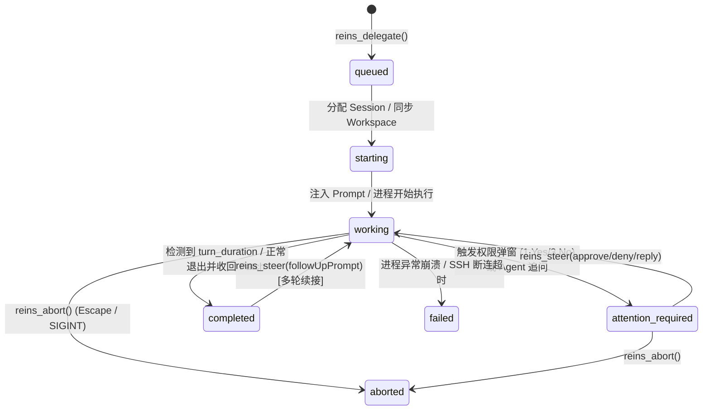

# Reins H2H (Harness-to-Harness) Protocol Specification v0.1

> **状态**：Draft v0.1  
> **定位**：定义不同 AI Coding Harness（本机或跨机远程）之间通过 **Reins Hub** 进行能力发现、任务派发、多轮协同、权限托管与移动端通知同步的标准协议模型。

---

## 1. 核心术语与隐喻映射（Equestrian Metaphor Mapping）

为了在协议层、MCP 工具层与未来的手机 App 端保持高度一致的心智模型，Reins 采用以下标准术语：

| 术语 | 协议对象 / 原语 | 含义说明 |
| :--- | :--- | :--- |
| **Target (Harness Node)** | `HarnessCard` | 一个可被调用的目标 Harness 实例（例如：`local-dsh`、`local-codex`、`remote-faex1-claude`、`remote-vps-claude`）。 |
| **Rein Policy（控缰策略）** | `ReinPolicy` | 权限与自主度级别：<br>• `free-rein`：全自动放行，不弹窗（适用于受控沙盒）；<br>• `parent-rein`：遇到权限请求时挂起并交由调用方（父 Harness）决定；<br>• `tight-rein`：遇到高危操作或权限请求时，挂起并推送到人类手机端审批。 |
| **Hand Over（移交缰绳）** | `reins_delegate` | 父 Harness 将子任务派发给目标 Harness（支持同步等待或异步返回 `taskId`）。 |
| **Steer（牵引/转向）** | `reins_steer` | 向正在运行或处于 `attention_required` 状态的任务追加指令、回复追问或作出权限审批（Allow/Deny）。 |
| **Pull the Reins（勒停）** | `reins_abort` | 紧急中断目标 Harness 当前正在执行的回合（如向 tmux 发送 `Escape`/`Ctrl-C` 或终止子进程）。 |

---

## 2. 目标能力声明：`HarnessCard`

每个注册在 Reins 中的本机或远程 Harness 节点，对外暴露标准化的 `HarnessCard` 结构（灵感源自 A2A 的 Agent Card，但针对 Coding Harness 进行了工程化扩展）：

```json
{
  "id": "faex1-claude",
  "label": "FAEX1 Remote Claude Code",
  "harnessType": "claude-code",
  "transport": {
    "kind": "ssh",
    "sshHost": "faex1",
    "platform": "linux"
  },
  "driver": {
    "mode": "tmux-jsonl",
    "binaryPath": "/home/pren/n/bin/claude",
    "supportsResume": true,
    "supportsInteractiveApproval": true
  },
  "workspace": {
    "defaultWorkdir": "/home/pren/tmp/reins-workspace",
    "syncModes": ["remote-native", "git-patch", "context-only"]
  },
  "reinPolicy": "tight-rein",
  "capabilities": ["coding", "refactoring", "code-review", "linux-shell"],
  "status": "idle"
}
```

### 支持的 `driver.mode`（南向驱动模式）
1. **`tmux-jsonl`**：通过 `tmux` 维持真实交互式 TUI 会话，并监听本地/远端 JSONL 转录文件获取结构化输出（专为禁止 `-p` 或需要完整交互特性的 Claude Code 等设计）。
2. **`acp`**：通过 **Agent Client Protocol** (stdio JSON-RPC 2.0) 驱动（如 `dsh --profile acp` 或各类 ACP Adapter）。
3. **`stream-json`**：通过无头 CLI 流式 JSON 模式驱动（如 `codex exec --json`、`claude -p --output-format stream-json`）。
4. **`headless-oneshot`**：通过单次命令调用获取标准输出（如 `dsh --profile headless "<prompt>"`）。

---

## 3. H2H 任务状态机（Task Lifecycle State Machine）

为兼容 MCP `2026-07-28` 异步任务扩展（`io.modelcontextprotocol/tasks`）并支持移动端实时接管，每个 H2H 任务遵循以下状态流转：



### 状态枚举定义
- **`queued`**：任务已接收，正在等待目标 Harness 空闲或队列调度。
- **`starting`**：正在唤醒本地进程或远程 SSH/Tmux 会话，并执行前置 Workspace 同步。
- **`working`**：目标 Harness 正在思考或执行工具调用（可实时读取增量 `events` 和最新 `assistant` 消息片段）。
- **`attention_required`** *(核心状态)*：目标 Harness 暂停，等待外部决策。细分为：
  - `permission_prompt`：例如请求执行命令或修改敏感文件（附带弹窗原文与候选按键 `allow` / `allow_session` / `deny`）。
  - `clarification_needed`：子 Harness 向调用方提出问题。
- **`completed`**：当前回合圆满结束，返回最终回复文本、修改的文件列表及可选的 `gitPatch`。
- **`failed`**：发生不可恢复错误。
- **`aborted`**：被父 Harness 或手机端用户主动勒停（Pull the reins）。

---

## 4. 跨机工作区上下文契约（Workspace Handoff Contract）

当 Harness A（如 Windows 本机的 Antigravity）调用 Harness B（如 Linux 远端 `faex1` 上的 Claude Code）时，`reins_delegate` 支持指定以下三种 `workspaceMode`：

### 4.1 `remote-native`（远端原生目录模式）
- **适用场景**：项目代码本来就存放在远程服务器上，或者希望远程 Harness 在其固定沙盒目录中独立完成任务。
- **行为**：Reins 直接在远端指定 `workdir` 启动 Harness，不进行跨机文件搬运。

### 4.2 `git-patch`（Git 补丁接力模式）
- **适用场景**：本机与远端都克隆了同一个 Git 仓库，本机主 Agent 希望让远端 Subagent 在隔离分支/Worktree 中完成某个模块的开发并把代码改回本机。
- **行为**：
  1. **派单前（Pre-flight）**：提取本机当前 commit hash 及未提交的 `git diff`，通过 SSH 发送至远端并在独立的 `git worktree` 中对齐状态。
  2. **执行中**：远端 Harness 在该 worktree 中自由编码、运行测试。
  3. **完工后（Post-flight）**：自动在远端生成 `git diff` / `format-patch` 回传至本机，包含在任务结果 `artifacts.gitPatch` 中，由主 Agent 或人类在手机端审阅后 Apply。

### 4.3 `context-only`（纯上下文内联模式）
- **适用场景**：架构设计咨询、疑难 Bug 会诊（Second Opinion）、独立算法编写或代码审查。
- **行为**：将主 Agent 选定的文件内容或报错日志直接内联打包进结构化 Prompt 发送给目标 Harness，在临时隔离目录中执行，仅取回分析结论或代码片段。

---

## 5. 调用链防环协议头（Loop & Recursion Guard）

为了防止多 Harness 互相调用产生无限递归（如 `Antigravity -> DSH -> Claude Code -> Antigravity`），Reins 在每次派发任务时强制维护调用链元数据，并通过环境变量注入子进程/远端会话：

```json
{
  "traceId": "tr_01j9x8k2m...",
  "hopCount": 1,
  "maxHops": 3,
  "callChain": ["antigravity@local", "dsh@local"]
}
```

- **注入环境变量**：
  - `REINS_TRACE_ID`: 全局追踪 ID
  - `REINS_HOP_COUNT`: 当前跳数（每次转发 `+1`）
  - `REINS_CALL_CHAIN`: 逗号分隔的已途经节点 ID 列表
- **拦截规则**：
  1. 若 `hopCount >= maxHops`（默认 `3`），拒绝继续向下派发子任务；
  2. 若目标 `targetId` 已经出现在 `callChain` 中（检测到环路），直接报错拦截（除非显式开启多轮乒乓辩论模式并设定最大轮次）。

---

## 6. 北向 MCP 工具集定义（MCP Tools Surface）

Reins MCP Server 向宿主暴露以下 5 个精简、正交的工具：

| MCP 工具名 | 核心参数 | 说明 |
| :--- | :--- | :--- |
| **`reins_targets`** | `filterCapability?`, `includeStatus?` | 列出所有已配置的本机与远程 Harness 节点、当前忙闲状态及支持的能力标签。 |
| **`reins_delegate`** | `target`, `prompt`, `workdir?`, `workspaceMode?`, `sessionId?`, `waitSec?`, `reinPolicy?` | **核心派单工具**。支持指定 `waitSec`（例如等待 30 秒，若未完成则自动转为后台运行并返回 `taskId` 供后续查询，完美避免 MCP 超时）。 |
| **`reins_status`** | `taskId`, `includeTranscriptTail?` | 查询指定任务或会话的当前状态（`working` / `attention_required` / `completed`）、最新进展摘要及待审批弹窗内容。 |
| **`reins_steer`** | `taskId`, `action` (`reply` \| `approve` \| `ApproveSession` \| `deny`), `message?` | 对处于 `attention_required` 的任务作出审批决策，或向已完成/运行中的会话发送追问与修正指令。 |
| **`reins_abort`** | `taskId` | 紧急中断目标任务（勒住缰绳），释放占用的 Harness 会话。 |

---

## 7. 移动端通知与管控事件标准（H2M Event Schema）

当任务状态发生变化（尤其是进入 `attention_required`、`completed`、`failed`）时，`reins-hub` 产生标准化的事件负载，同时推送给通知渠道（ntfy / Bark / Webhook）与未来的 **Reins App**：

```json
{
  "eventId": "evt_9921a",
  "timestamp": "2026-11-06T21:18:00Z",
  "eventType": "task.attention_required",
  "task": {
    "taskId": "tsk_7f8a9",
    "caller": "antigravity@local",
    "target": "faex1-claude",
    "title": "重构音频流解码模块并补充单元测试",
    "status": "attention_required"
  },
  "attention": {
    "kind": "permission_prompt",
    "summary": "Claude Code (faex1) 请求执行 Shell 命令: rm -rf ./build && cmake -B build",
    "rawPaneTail": "Do you want to proceed?\n❯ 1. Yes\n  2. Yes, and don't ask again for this session\n  3. No",
    "actions": [
      { "id": "approve", "label": "✅ 允许本次 (Yes)", "style": "primary" },
      { "id": "approve_session", "label": "⏩ 本会话不再询问", "style": "secondary" },
      { "id": "deny", "label": "🛑 拒绝 (No)", "style": "danger" }
    ]
  }
}
```
